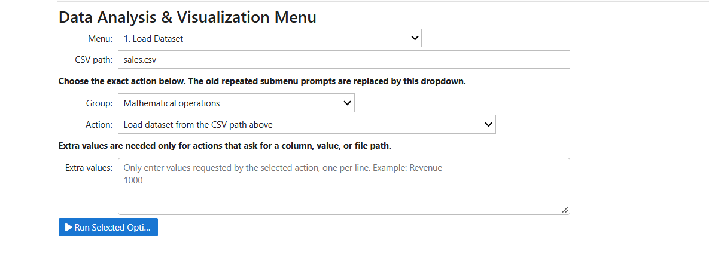
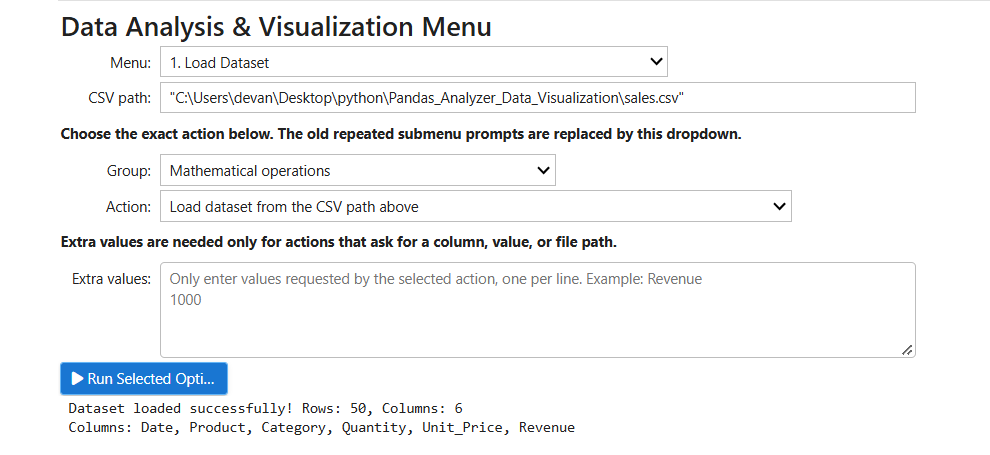
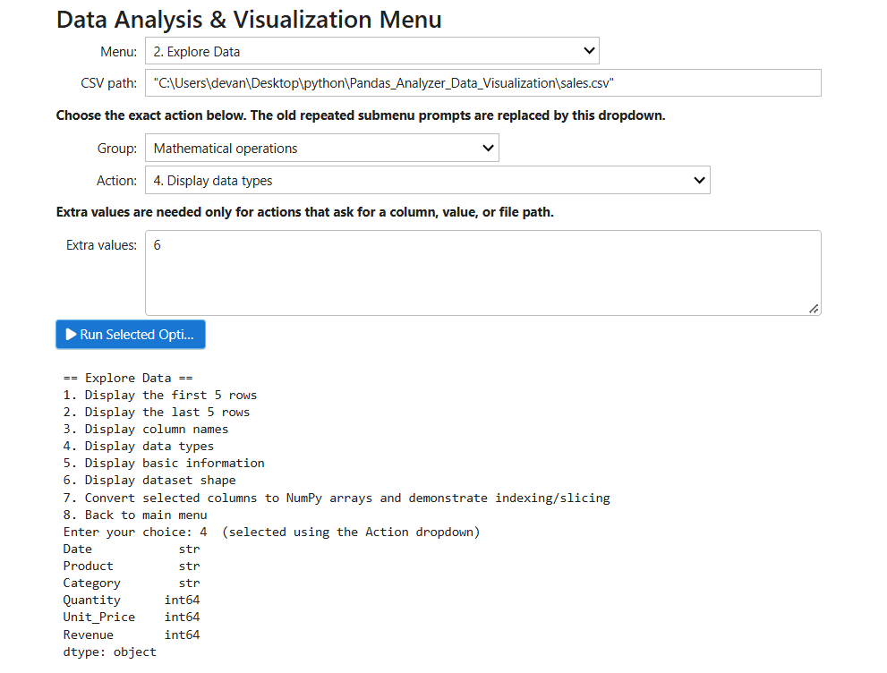
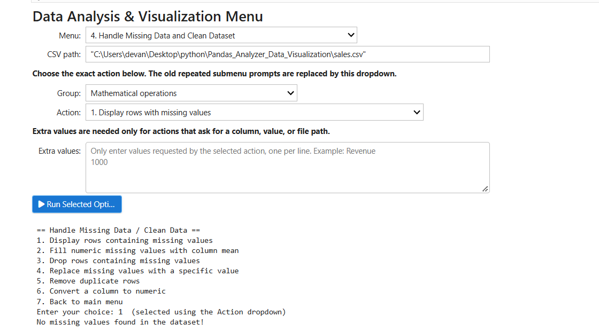
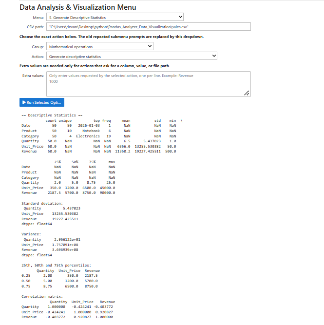
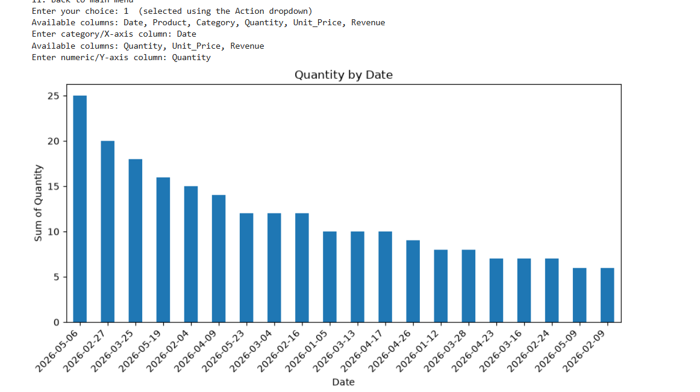
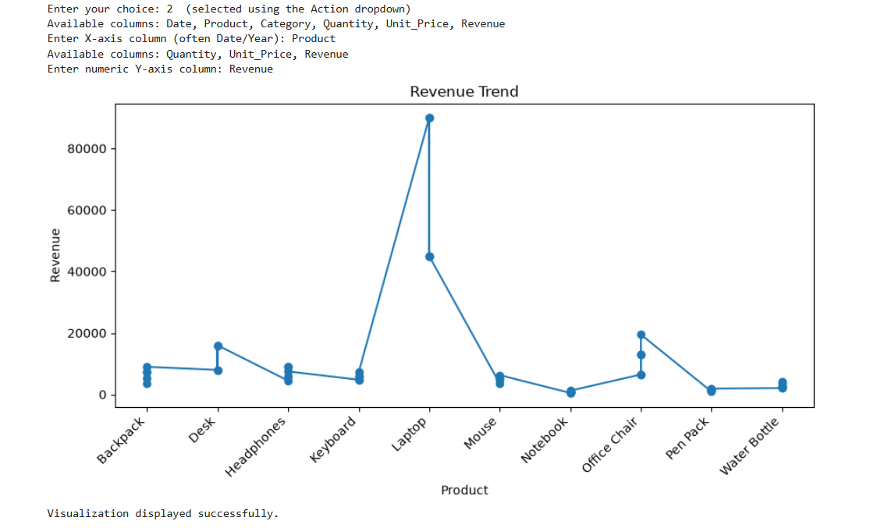
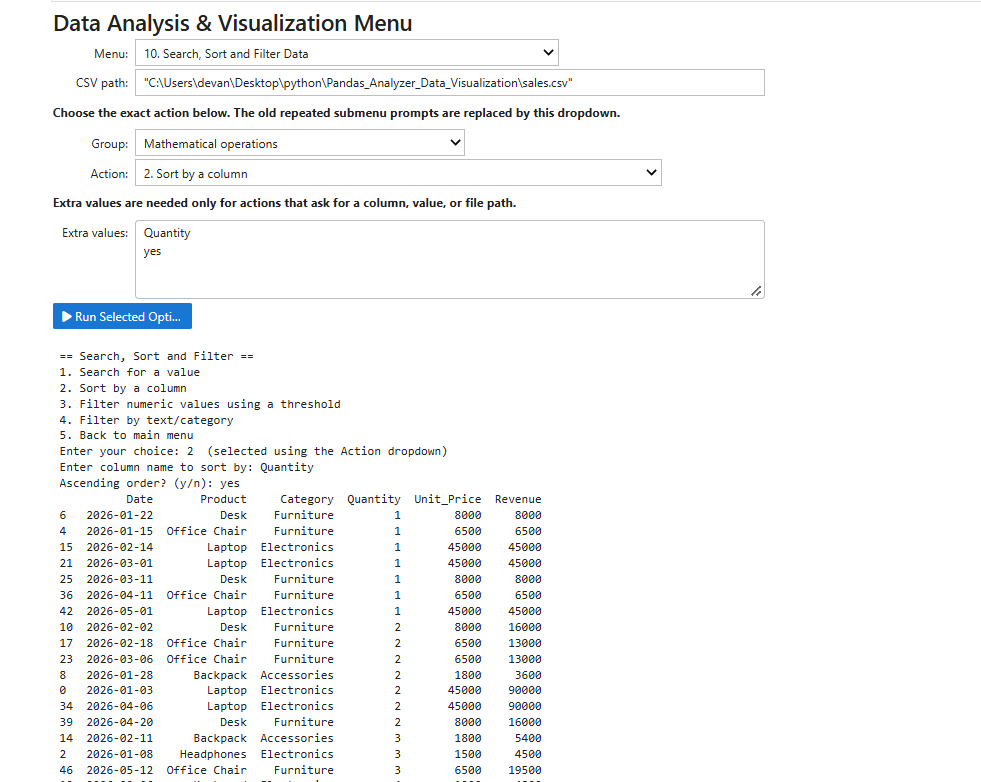

# Pandas Analyzer & Data Visualization

## 📌 Project Overview

**Pandas Analyzer & Data Visualization** is a Python-based data analysis project developed using Pandas, NumPy, Matplotlib, Seaborn, and Jupyter Notebook.

The main purpose of this project is to simplify data analysis by providing an interactive, menu-driven interface. Users can load CSV datasets, explore data, clean missing values, perform mathematical operations, calculate statistics, filter records, and generate different types of visualizations.

The project uses interactive dropdown menus and buttons in Jupyter Notebook, allowing users to select operations without repeatedly entering menu numbers in the terminal.

## 🎯 Objectives

- To load and analyze CSV datasets using Pandas.
- To understand and manipulate structured data using DataFrames.
- To identify and handle missing values and duplicate records.
- To perform mathematical and numerical operations using NumPy.
- To calculate descriptive statistics and aggregate results.
- To search, sort, and filter dataset records.
- To create meaningful charts using Matplotlib and Seaborn.
- To provide an interactive and user-friendly data analysis interface.
- To improve practical knowledge of Python programming and data visualization.

## ✨ Features

### 1. Load Dataset
- Load data from a CSV file.
- Read the dataset into a Pandas DataFrame.
- Display the loaded dataset for further analysis.

### 2. Explore Data
- Display the first five rows of the dataset.
- Display the last five rows.
- View column names.
- Display data types of columns.
- Display basic dataset information.
- Check the number of rows and columns.
- Convert selected columns into NumPy arrays.
- Demonstrate array indexing and slicing.

### 3. Mathematical Operations
- Perform supported mathematical calculations on dataset columns.
- Work with numerical values using Pandas and NumPy.
- Analyze numerical data for better understanding.

### 4. Data Cleaning
- Display rows containing missing values.
- Fill numeric missing values using the column mean.
- Drop rows containing missing values.
- Replace missing values with a specified value.
- Remove duplicate rows.
- Convert selected columns into numeric data types.

### 5. Descriptive Statistics
- Generate summary statistics for numerical columns.
- Analyze values using measures such as mean, standard deviation, minimum, and maximum where supported.
- Understand the distribution and characteristics of the dataset.

### 6. Data Visualization
The project supports various visualization options, depending on the implemented notebook functions.

- **Bar Chart:** Compare values across categories.
- **Line Chart:** Display trends and changes across ordered data.
- **Scatter Plot:** Examine relationships between numerical variables.
- **Pie Chart:** Show proportions among categories.
- **Histogram:** Understand the distribution of numerical values.
- **Stack Plot:** Compare cumulative values across categories.
- **Heatmap:** Display numerical relationships or patterns using colors.
- **Box Plot:** Examine distributions and potential outliers.
- **Count Plot:** Compare the frequency of categorical values.
- **Multiple Plots and Subplots:** Display multiple visualizations together.

### 7. Save Visualization
- Save generated charts as image files when supported by the selected operation.
- Use saved visualizations in project reports and documentation.

### 8. Combine Datasets
- Load another CSV dataset.
- Combine datasets using the supported combination operation.
- Work with the resulting data for further analysis.

### 9. Split Dataset
- Split dataset records based on a selected column or supported condition.
- Analyze separate groups of data independently.

### 10. Search, Sort, and Filter
- Search for specific values in the dataset.
- Sort records using selected columns.
- Filter numerical data using a threshold.
- Filter records based on text or category values.

### 11. Aggregation Functions
- Summarize groups of data.
- Calculate aggregate results for supported columns.
- Compare values across different categories.

### 12. Pivot Table
- Create pivot tables using selected dataset columns.
- Organize data into summarized tables.
- Compare values across groups.

### 13. Interactive Menu
- Select the main operation using a dropdown.
- Choose a specific action using the available action controls.
- Enter additional values when an operation requires them.
- Execute the selected action using the **Run Selected Option** button.
- Display the result in the notebook output area.

## 🛠️ Technologies Used

| Technology | Purpose |
|---|---|
| Python | Main programming language |
| Pandas | Dataset loading, cleaning, and analysis |
| NumPy | Numerical calculations and array operations |
| Matplotlib | Creating charts and plots |
| Seaborn | Statistical data visualization |
| Jupyter Notebook | Interactive development environment |
| ipywidgets | Dropdown menus, input fields, and buttons |

## 📂 Project Structure

```text
Pandas_Analyzer_Data_Visualization/
│
├── Pandas_Analyzer_Data_Visualization_Interactive.ipynb
├── sales.csv
├── sample_sales_data.csv
├── README.md
└── screenshots/
    ├── main_menu.png
    ├── load_dataset.png
    ├── explore_data.png
    ├── data_cleaning.png
    ├── statistics.png
    ├── bar_chart.png
    ├── line_chart.png
    ├── pie_chart.png
    ├── heatmap.png
```

**Note:** The screenshot folder and `sample_sales_data.csv` are optional. The sample CSV is available only if you create it using the optional sample-data cell. Your actual notebook and dataset filenames may differ.

## 📋 Requirements

Make sure Python 3 and Jupyter Notebook are installed on your computer.

The project uses the following Python libraries:

- pandas
- numpy
- matplotlib
- seaborn
- ipywidgets

## ⚙️ Installation and Setup

### Step 1: Download the Project

Download or clone the project repository to your computer.

### Step 2: Open the Project Folder

Open the project folder in VS Code or navigate to it using your terminal.

### Step 3: Install Required Libraries

Run the following command in your terminal:

```bash
pip install pandas numpy matplotlib seaborn ipywidgets
```

If you use Anaconda, you can also install and run Jupyter Notebook through the Anaconda environment.

### Step 4: Open Jupyter Notebook

Open the notebook:

`Pandas_Analyzer_Data_Visualization_Interactive.ipynb`

### Step 5: Run the Notebook

Run the notebook cells from top to bottom in the correct order.

If you see old output or errors from a previous execution, select:

**Kernel → Restart Kernel and Clear Outputs**

Then run the notebook cells again from the beginning.

### Step 6: Load the Dataset

Place `sales.csv` in your project folder or provide its full file path in the CSV path field.

For example:

```text
C:\Users\YourName\Desktop\Pandas_Analyzer_Data_Visualization\sales.csv
```

Replace `YourName` with your Windows username and make sure the path matches your actual file location.

Select **Load Dataset** from the main menu and click **Run Selected Option**.

## ▶️ How to Use the Project

### Step 1: Select an Operation

Choose the required operation from the main menu dropdown.

### Step 2: Select an Action

Choose the specific action from the Action dropdown.

### Step 3: Enter Additional Values

Some operations require extra information, such as a column name, threshold, category, or second CSV file path.

Enter the requested values in the Extra values field, following the instructions shown in the notebook.

### Step 4: Run the Operation

Click **Run Selected Option** to execute the selected task.

### Step 5: View the Results

The output area displays the results of the selected operation.

### Example: Exploring a Dataset

1. Select **Explore Data**.
2. Choose **Display first 5 rows**.
3. Click **Run Selected Option**.
4. View the first five records in the output area.

### Example: Cleaning Data

1. Load the dataset.
2. Select **Data Cleaning**.
3. Choose the required cleaning operation.
4. Provide any requested values.
5. Run the operation and inspect the result.

### Example: Creating a Chart

1. Load the dataset.
2. Select **Data Visualization**.
3. Choose the required chart type.
4. Enter the requested column names or other values.
5. Click **Run Selected Option** to generate the visualization.

## 📊 Sample Dataset

The project can be used with a sales dataset containing columns such as:

| Column | Description |
|---|---|
| `Date` | Date of the sale |
| `Product` | Name of the product |
| `Category` | Product category |
| `Quantity` | Number of units sold |
| `Unit_Price` | Price per unit |
| `Revenue` | Total revenue from the sale |

Revenue can be calculated using:

```python
Revenue = Quantity * Unit_Price
```

The actual column names depend on the CSV file being used. Select column names that exist in your loaded dataset when performing analysis.

## 📸 Project Screenshots

Add screenshots of your actual notebook outputs to a folder named `screenshots` in the project directory. Upload that folder to GitHub to display the screenshots in this README.

### 1. Main Menu

Shows the interactive menu used to select different data analysis operations.



### 2. Dataset Loading

Shows the dataset after loading the CSV file into Pandas.



### 3. Explore Data

Displays dataset rows, column names, data types, and basic information.



### 4. Data Cleaning

Demonstrates the available operations for handling missing values and duplicate records.



### 5. Descriptive Statistics

Shows summary statistics calculated from the dataset.



### 6. Bar Chart

Compares values across different categories.



### 7. Line Chart

Displays changes or trends across ordered data.



### 8. Pie Chart

Shows the proportions of different categories.


### 9. Heatmap

Displays numerical patterns or relationships using colors.


### 10. Search, Sort, and Filter

Demonstrates searching for values, sorting records, and filtering data.



## 🧪 Testing

The project can be tested using a suitable CSV dataset.

Suggested tests include:

- Loading a valid CSV file.
- Displaying the first and last five records.
- Checking column names and data types.
- Finding rows with missing values.
- Removing duplicate records.
- Performing supported mathematical operations.
- Searching, sorting, and filtering data.
- Generating different types of charts.
- Testing operations with appropriate column names and values.

## 🛠️ Troubleshooting

### CSV File Not Found

Check that the CSV path is correct and that the file exists at that location.

### Dataset Not Loaded

Load the CSV file successfully before running analysis, cleaning, or visualization operations.

### Module Not Found

Install the missing library using pip. For example:

```bash
pip install matplotlib
```

Replace `matplotlib` with the name of the missing package if necessary.

### Interactive Controls Not Displaying

Install or update `ipywidgets`, restart the kernel, and run the notebook cells again.

```bash
pip install --upgrade ipywidgets
```

### Old Output Still Appearing

Restart the kernel, clear the old outputs, and run the notebook cells from top to bottom.

### Column Name Error

Check the exact spelling of the column name in the dataset. Column names must match those displayed by Pandas.

## 🎓 Learning Outcomes

By completing this project, I gained practical experience in:

- Python programming and data handling.
- Reading CSV files using Pandas.
- Working with DataFrames and NumPy arrays.
- Handling missing values and duplicate records.
- Performing mathematical and statistical analysis.
- Searching, sorting, filtering, and aggregating data.
- Creating visualizations using Matplotlib and Seaborn.
- Building interactive interfaces using Jupyter widgets.
- Organizing and documenting a Python project.
- Presenting data in a format that is easier to understand.

## 🚀 Future Enhancements

Possible future improvements include:

- Adding more validation for user inputs.
- Supporting additional file formats.
- Exporting cleaned datasets and analysis reports.
- Adding more advanced statistical calculations.
- Improving chart customization and formatting.
- Adding more sample datasets.
- Creating a standalone web interface for data analysis.

## 👨‍💻 Author

**Devansh Patel**

## 📌 Conclusion

Pandas Analyzer & Data Visualization demonstrates how Python libraries can be combined to perform data analysis and create meaningful visualizations. The project brings together dataset loading, exploration, cleaning, calculations, filtering, and chart generation in one interactive Jupyter Notebook.

It is an educational project designed to strengthen practical skills in Python, data analysis, and data visualization.
